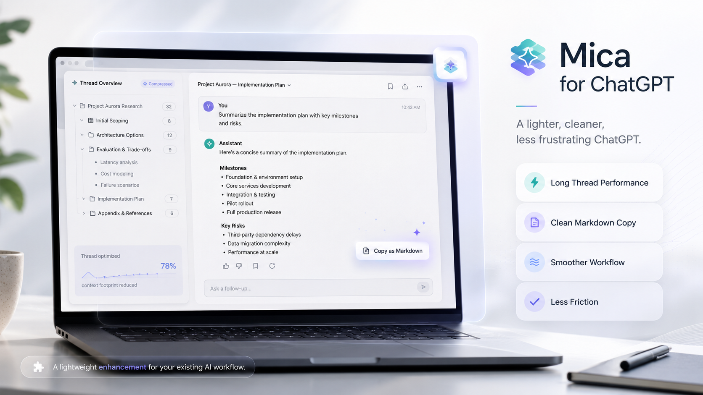

# Mica for ChatGPT

> 在 ChatGPT 原生界面上补齐可靠复制、发送恢复和研究整理能力。



Mica 是一个本地运行的 Chromium 扩展。它不接管 ChatGPT，也不依赖外部后端；遇到无法确认的页面结构时保持原生行为，不猜测注入位置或恢复动作。

当前开发候选版为 `0.4.1`。这一版本包含：

- 将单条 assistant answer 复制为稳定的 Markdown，并把 inline/display LaTeX 保留为 `$…$` / `$$…$$`；
- 为 Notion 同时写入 `text/html` 与可读的 `text/plain` fallback；
- 生成带文本层、公式和本地高亮的 PDF 预览；
- 将 answer 选区高亮保存在本机，并在刷新或 turn remount 后按上下文恢复；
- 在超长 conversation 中只把最近 40 turns 交给页面运行时，显著减少历史 mapping、DOM 与 JS heap；需要旧历史时可一键恢复完整原生会话；
- 以 `send_intent -> user_committed -> assistant_generating -> settled` 为主线识别 ghost send、fake waiting、stale response 和 generation error；
- 只在已验证的 native action cluster 中显示页面 Copy 按钮，未知结构一律不注入；
- 提供独立的 Troubleshooting 页面，用一次有界检查采集不含正文的结构报告。

## 安装开发版

固定的 unpacked 目录是：

```text
D:\Code\Mica-for-ChatGPT\dist\mica-dev
```

首次安装：

1. 打开 `edge://extensions` 或 `chrome://extensions`；
2. 开启开发人员模式；
3. 选择“加载解压缩的扩展”；
4. 选择 `D:\Code\Mica-for-ChatGPT\dist\mica-dev`。

后续版本只需重新构建，并在扩展管理页点击 Reload；不需要重新选择目录。

```bash
pnpm install
pnpm run build
```

## 日常使用

Popup 只保留四个产品层级：

- **Copy & Export**：复制 Markdown、复制到 Notion、打开 PDF 预览；
- **Low-memory mode**：超长 conversation 只保留最近 40 turns 活跃，并提供完整历史恢复入口；
- **Reliability**：正常时保持安静，只在高置信异常时给出一个安全动作；
- **Page integration**：说明当前页面是已验证集成还是保持原生处理。

选择 assistant answer 中的正文后，Mica 会显示一个短暂的 `Highlight` 入口。高亮只保存在当前浏览器的本地存储中；找不到唯一位置时不会猜测恢复。

Troubleshooting 位于 Advanced 中的独立入口。它只在用户主动开始检查时记录 element identity、尺寸、计数和有界 lifecycle event，不记录 prompt 或 answer 文本。

## 当前边界

- 0.4.1 仍是本地候选版；在当前已登录 ChatGPT 的一次合并验收完成前，不把低内存数据窗口、页面 Copy 注入、connector/remount 或真实发送生命周期报告为最终真实站点通过。
- Low-memory mode 默认仅保留最近 40 turns。它优先在页面消费 conversation mapping 前裁掉旧分支数据；若当前响应结构不匹配，只在 120+ 个可安全识别的普通 turn 上使用 DOM fallback；未知、分支、streaming、tool/file/auth 等结构一律保持原生行为。
- `Load full history` 会为当前 conversation 设置一次会话级 bypass 并刷新；关闭 Mica 后刷新也会重新从服务器取得完整历史。Mica 不删除或写回服务器 conversation。
- Notion-ready 输出的本地 HTML/text 合同已验证；Notion 网页端如何解释任意 clipboard HTML 不是其公开稳定 API，因此精确粘贴结果在完成一次真实验证前保持 `UNVERIFIED`。
- Mica 不自动重发，不点击授权、安全、付费、工具或 connector 确认。Low-memory mode 只在页面内过滤同源 conversation GET 的已有 JSON 响应，不新增请求、不读取 cookie/token/header/request body，也不上传内容；接口或 graph 结构漂移时 fail-open。

## 验证

```bash
pnpm run test
pnpm run test:e2e
pnpm run test:e2e:stress
pnpm run package:release
```

测试使用隔离的真实 Edge 扩展上下文和仓库内脱敏 fixture，不连接用户日常 Edge profile，也不自动操作已登录 ChatGPT。详细证据见 [`results/mica--product-recovery-current-gpt-ui/`](results/mica--product-recovery-current-gpt-ui/)。

## 隐私与权限

Mica 默认本地运行，不上传聊天正文。Manifest 仅使用 `storage`、`activeTab` 与页面 Copy 所需的 `clipboardWrite`，并将 host 权限限制为 `chatgpt.com` 与 `chat.openai.com`。诊断报告不包含 cookie、token、header、request body、附件或聊天正文。

版本、稳定开发路径与发布包规则见 [`docs/VERSIONING.md`](docs/VERSIONING.md)；当前产品边界见 [`docs/product/MICA_PRODUCT_CONTRACT.md`](docs/product/MICA_PRODUCT_CONTRACT.md)。
